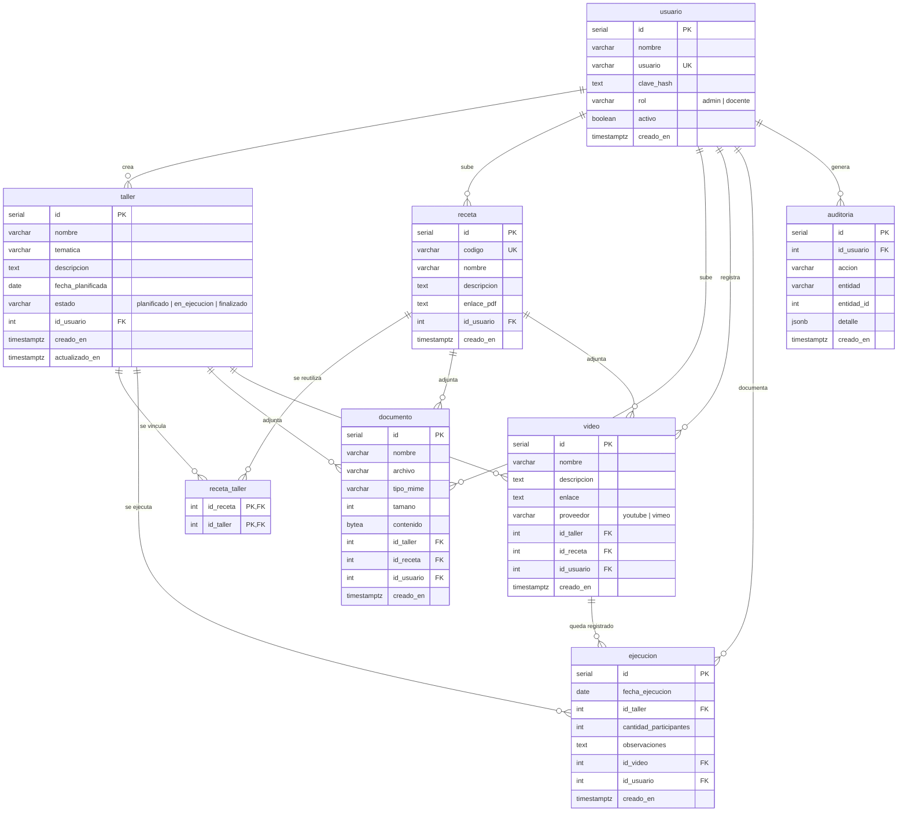

# Modelo de datos

## Diagrama

El esquema real, con todas las restricciones, es `app/src/schema.sql`. Ese archivo es la fuente de
verdad: si el diagrama y el SQL se contradicen, manda el SQL.

## Decisiones

### Receta y taller: muchos a muchos

El diagrama del SRS (<docs/img/diagrama-srs.png>) pone `idTaller` dentro de `recetaTaller`, lo que ata
cada receta a un solo taller. El RF-04 pide lo contrario: la receta es una ficha independiente que se
reutiliza en varios talleres sin volver a ingresarla. Se resuelve con `receta_taller` (llave primaria
compuesta). Si se hubiera seguido el diagrama, la misma receta aparecería duplicada tantas veces como
talleres la usen, y dos copias se desactualizan a distinto ritmo.

### Documento y video: un destino y solo uno

Un documento o un video pertenece a un taller **o** a una receta, nunca a los dos y nunca a ninguno. Eso
no se deja al formulario: lo garantiza una restricción `CHECK` en la base. Si mañana la aplicación tiene
un error, la base sigue diciendo la verdad.

### Cantidad de participantes, no nombres

El SRS pide "cantidad de participantes". Los talleres son con estudiantes de un taller laboral, muchos
menores con discapacidad intelectual: sus nombres son dato sensible. La plataforma guarda el número y
nada más. Es una decisión de privacidad, no una simplificación.

### Fechas

`fecha_planificada` y `fecha_ejecucion` son `DATE` (día, sin hora); el resto son `TIMESTAMPTZ`. El
controlador de `pg` devuelve las `DATE` como texto `aaaa-mm-dd` para que un servidor en otra zona horaria
no corra la fecha un día.

### `codigo` de receta único

El RF-04 pide "un identificador de la receta". Se hace `UNIQUE` para que no existan dos fichas con el
mismo código: es lo que permite citar una receta en un papel sin ambigüedad.

### Auditoría como tabla, no como archivo de log

Va en PostgreSQL para poder consultarla desde la aplicación (`/admin/auditoria`) y para que sobreviva a
un reinicio del servidor. `detalle` es `JSONB` para anotar lo que cambió sin migrar el esquema cada vez.

## Operaciones

- Crear el esquema: `npm run instalar` (idempotente).
- Datos de ejemplo: `npm run seed` (no hace nada si ya existen usuarios).
- Respaldo y restauración: `docs/operacion.md`.

## Diferencia con el diagrama del SRS

El diagrama original del SRS está en `docs/img/diagrama-srs.png`, tal como lo entregó el equipo. Se
mantiene en el repositorio para poder comparar en la revisión con el tutor.
